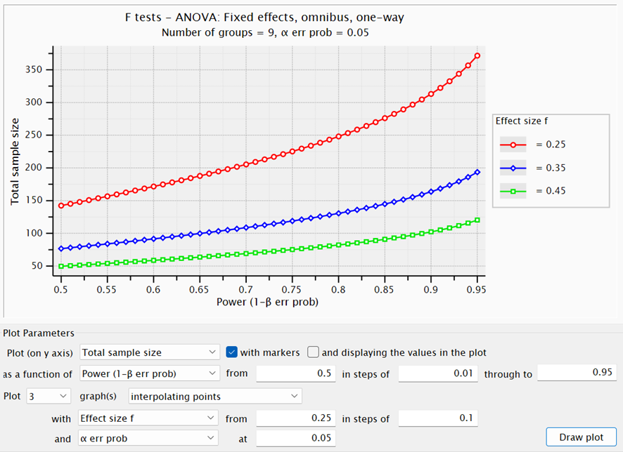
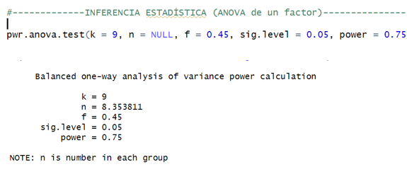

## **¿Qué es un data scientist? Diferencias y similitudes entre data science y data analysis**

La ciencia de datos (data science) es una ciencia interdisciplinar que se nutre y utiliza múltiples áreas de conocimiento como la estadística, la programación e incluso otras ramas de la informática en combinación con la información que recibe del entorno de interés (una consultoría, un laboratorio que trabaja con datos biológicos, una industria cárnica, etc.) para entender, procesar, analizar y extraer conclusiones sobre los datos recogidos de dicho entorno. El científico de datos (data scientist), básicamente, se encarga de manejar y crear código utilizando conocimientos de informática y matemáticas para no solo analizar esos datos, sino llegar a sus propias conclusiones y sugerir y contestar a nuevas preguntas sobre el objeto de interés.

Un analista de datos (data analyst) también se encarga de procesar y analizar información para responder a preguntas a partir de un proceso de selección y análisis de datos. Sin embargo, las diferencias son claras entre el trabajo que realiza un data analyst y el trabajo que realiza un data scientist. Es más, en muchas empresas suelen convivir ambos tipos de especialistas que tienen focalizaciones distintas. Vemos las principales diferencias:

-   En primer lugar, el data analyst normalmente solo responde a las preguntas que se le ofrecen en ese entorno de trabajo. Es decir, procesa y analiza los datos para obtener respuestas a las preguntas concretas que la empresa le encarga. Sin embargo, el data scientist va más allá y es capaz de entender la información de manera no tanto descriptiva sino para ser capaz de derivar nuevas preguntas a futuro.

-   Por otro lado, en relación a lo anterior, el data analyst se centra más en lo que respecta a análisis descriptivo, visualización de datos y la identificación de patrones o tendencias para responder a esas preguntas (por ejemplo, hacer regresiones lineales o logísticas o un ANOVA/MANOVA de forma detallada para ver patrones, tendencias o interacciones entre datos). En cambio, el data scientist, debido a su enfoque más amplio, se centra más en análisis predictivo, modelización de datos, machine learning y sobre todo, en la generación de paquetes y software para ser usado a posteriori de ser necesario, reutilizando la información y los modelos para ser usados a futuro.

Así, mientras que el data analyst no se sale tanto de su enfoque estadístico-matemático para ofrecer insights sobre los datos, el data scientist enfoca el problema desde una perspectiva más a futuro creando software que le pueda servir a la persona/empresa interesada, transformando los datos en modelos complejos para plantear otras preguntas, incluso por el propio data scientist.

## **¿Qué es el poder estadístico? ¿Cómo se relaciona con el efecto estadístico?**

El poder estadístico o la potencia estadística de un test (suponemos no aleatorizado) mide la capacidad de un test de detectar errores de tipo II, es decir, la probabilidad de aceptar la hipótesis nula H0 (que conocemos) dado que H0 es falsa.

En otras palabras, el poder estadístico mide la capacidad de un estudio para identificar un efecto de estar este presente. Un poder estadístico bajo quiere decir que existe un mayor riesgo de no detectar efectos reales por lo anteriormente dicho, lo que puede llevar a una conclusión errónea. Por eso, en investigación y análisis de laboratorio, se suele buscar un poder estadístico mínimo de 0,80 (80%), lo que implica que hay un 80% de probabilidad de detectar un efecto si realmente existe, aunque dependiendo de la viabilidad de hacer más o menos réplicas independientes del experimento para cada grupo, podremos aceptar poderes estadísticos de 0,60-0,70 (menos de 0,50 en general no, aunque en algunos estudios no se suele hacer un análisis de poder previo al estudio y se aceptan poderes bajos), también dependerá de cuán formal queramos que sea el estudio. Aquí, por cómo es nuestro estudio (una probatina de laboratorio sencilla), hemos considerado un poder de 0,75 (cerca a 0,80) sin problemas, si bien como veremos es recomendable utilizar n \> 30 ya que en tal caso en general la distribución de los datos intergrupo (las réplicas) aproxima bien a una distribución normal (podremos suponer normalidad). El efecto a priori queremos que sea alto normalmente porque no solo queremos que el fármaco tenga algún efecto en la germinación, sino que queremos que el fármaco en cuestión tenga mucho efecto en esta.

Así, lo que hemos estudiado primeramente es el tamaño mínimo de muestra necesario para detectar un efecto de interés con una probabilidad adecuada. Aquí se muestra la gráfica para varios f desde 0.25 a 0.45 y poder de 0,75 y un  en un one-way ANOVA, que es lo que queremos estudiar.



Nuestra N (número total de réplicas independientes) es aproximadamente N = 81 según la gráfica en G\*Power para f = 0,45 y 1-β = 0,75 (el poder). Si lo hacemos en R, nos devuelve el número de réplicas por grupo que tenemos que tomar, que da n = 8,35, que redondeado hacia arriba es n = 9, que coincide con el análisis que hace G\*Power, con un efecto de f = 0,45 (muy alto, alto se considera en general más de 0,4).



## Código principal con pasos

### Preprocesamiento de datos

```{r}
# 1. Cargamos y preparamos los datos
farmaco <- read.table("C:/Users/dvalh/Desktop/UA/MatesUA/Prácticas de empresa + privado/Actividades 1 a 3/Actividad 1/estudiofarmaco.txt", sep = "\t", header = TRUE)

farmaconuevo1 <- na.omit(farmaco)

farmaconuevo2 <- farmaconuevo1  # Partimos de todos los datos sin filtrar
```

```{r}
# Si X._germinados > 100, lo dividimos entre 10
farmaconuevo2$X._germinados <- ifelse(farmaconuevo2$X._germinados > 100,
                                      farmaconuevo2$X._germinados / 10,
                                      farmaconuevo2$X._germinados)

niveles_trt <- c("C", "1", "2.5", "5", "7.5", "10", "20", "30", "DMSO_35")
farmaconuevo2$trt <- factor(farmaconuevo2$trt, levels = niveles_trt, ordered = TRUE)

farmaconuevo2$trtf <- paste0(farmaconuevo2$trt, "_", farmaconuevo2$time, "h")

niveles_trtf <- c(
  paste0(niveles_trt, "_8h"),
  paste0(niveles_trt, "_24h")
)

farmaconuevo2$trtf <- factor(farmaconuevo2$trtf,
                                 levels = niveles_trtf,
                                 ordered = FALSE)
```

```{r}
# Filtramos los datos
subfarmaco8 = droplevels(subset(farmaconuevo2, time == 8))
subfarmaco24 = droplevels(subset(farmaconuevo2, time == 24))
```

```{r}
# Instalamos y cargamos paquetes necesarios
if (!require("pwr", quietly = TRUE)) install.packages("pwr")
if (!require("Superpower", quietly = TRUE)) install.packages("Superpower")
if (!require("car", quietly = TRUE)) install.packages("car")
if (!require("DescTools", quietly = TRUE)) install.packages("DescTools")
if (!require("ggplot2", quietly = TRUE)) install.packages("ggplot2")

library(pwr)
library(Superpower)
library(car)
library(DescTools)
library(ggplot2)
```

### INFERENCIA ESTADÍSTICA (ANOVA de un factor)

```{r}
#-------------INFERENCIA ESTADÍSTICA (ANOVA de un factor)-------------------

pwr.anova.test(k = 9, n = NULL, f = 0.4, sig.level = 0.05, power = 0.7)
```

```{r}
#--Vemos cómo son los datos----------------

str(farmaconuevo2)
table(farmaconuevo2$trtf)

summary(farmaconuevo2) #AQUÍ VEO SI HAY QUE HACER CLEANING DE LOS DATOS
                       #O HAY COSAS QUE NO ENCAJAN
```

```{r}
#---------- ANOVA -----------

modelo_aov <- aov(X._germinados ~ trtf, data = farmaconuevo2) #Hacemos el anova
summary(modelo_aov)

shapiro.test(resid(modelo_aov))  # Normalidad
leveneTest(X._germinados ~ trtf, data = farmaconuevo2)  # Homogeneidad de varianzas

```

FALLAN TANTO LA NORMALIDAD COMO LA HOMOGENEIDAD, TRANSFORMAMOS LOS DATOS:

```{r}
#----------Si ANOVA significativo--------------

TukeyHSD(modelo_aov)

EtaSq(modelo_aov, type = 1) #TAMAÑO EFECTO eta^2
```

```{r}
#--------------------- TRANSFORMACIONES -------------------------

#PRIMERO PRUEBO CON UNA RAÍZ, POR EJEMPLO

farmaconuevo2$sqrt_germinados <- sqrt(farmaconuevo2$X._germinados)  # +1 para evitar log(0)
modelo_aov_sqrt <- aov(sqrt_germinados ~ trtf, data = farmaconuevo2)
summary(modelo_aov_sqrt)

shapiro.test(resid(modelo_aov_sqrt))
leveneTest(sqrt_germinados ~ trtf, data = farmaconuevo2)
```

```{r}
#PRUEBO CON UNA TRANSFORMACIÓN BOX-COX QUE OPTIMIZA LOS DATOS PARA
#QUE LA DISTRIBUCIÓN DE LOS DATOS SEA MÁS NORMAL Y LOS RESIDUOS
#MÁS HOMOGÉNEOS

library(MASS)
boxcox_result <- boxcox(farmaconuevo2$X._germinados ~ farmaconuevo2$trtf, lambda = seq(-4, 4, 0.1))
# El gráfico te indicará el lambda óptimo

lambda_optimo <- boxcox_result$x[which.max(boxcox_result$y)]
print(lambda_optimo)

if(abs(lambda_optimo) < 0.01) {
  farmaconuevo2$Y_trans <- log(farmaconuevo2$X._germinados + 1)  # +1 para evitar log(0)
} else {
  farmaconuevo2$Y_trans <- ((farmaconuevo2$X._germinados + 1)^lambda_optimo - 1)/lambda_optimo
}

modelo_aov_box <- aov(Y_trans ~ trtf, data = farmaconuevo2)
summary(modelo_aov_box)
```

```{r}
shapiro.test(resid(modelo_aov_box))
leveneTest(Y_trans ~ trtf, data = farmaconuevo2)
```

Como no hay normalidad ni homogeneidad, no hacemos nada y usamos #un test no paramétrico equivalente al ANOVA (Kruskal-Wallis + Dunn):

```{r}
#Vería TukeyHSD 

tukeybox = TukeyHSD(modelo_aov_box)
```

### Tests no paramétricos y boxplot

Hacemos los gráficos:

**GRÁFICO DE 8 H**

```{r}
#-------------------------------- TESTS NO PARAMÉTRICOS Y BOXPLOT --------------------------------------

#---------------8 H-------------------------
modelo_kruskal = kruskal.test(X._germinados ~ trtf, data = subfarmaco8)
modelo_kruskal

if(!require("FSA", quietly = TRUE)){install.packages("FSA")}
if(!require("rcompanion", quietly = TRUE)){install.packages("rcompanion")}
if (!require("multcompView", quietly = TRUE)) install.packages("multcompView")

library(FSA)
library(rcompanion)

# COMPRUEBO OTRA VEZ SI trtf es factor (debe ser factor, no ordered factor)
class(farmaconuevo2$trtf)
```

```{r}
# COMPRUEBO OTRA VEZ SI trtf es factor (debe ser factor, no ordered factor)
class(farmaconuevo2$trtf)

# Test de Dunn con corrección de Bonferroni (puedes usar "holm" o "BH" también)
dunn_result <- dunnTest(X._germinados ~ trtf,
                        data = subfarmaco8,
                        method = "bonferroni")

print(dunn_result)
```

```{r}

comparaciones <- dunn_result$res

#LETRAS

niveles_8h <- c("C_8h", "1_8h", "2.5_8h", "5_8h", "7.5_8h", "10_8h", "20_8h", "30_8h", "DMSO_35_8h")

library(multcompView)

# Formatear las comparaciones para multcompView
# multcompView necesita vector named con p-values y nombres del tipo "A-B"

# Convertir "A_8h - B_8h" a "A_8h-B_8h" para multcompView
names_pvals <- gsub(" ", "", gsub(" - ", "-", comparaciones$Comparison))

pvals <- comparaciones$P.adj
names(pvals) <- names_pvals

# Ahora generar el agrupamiento en letras
letters <- multcompLetters(pvals, threshold = 0.05)$Letters

# Ordenar letras según niveles_8h
letters_df <- data.frame(
  trtf = niveles_8h,
  Letters1 = letters[niveles_8h]
)
print(letters_df)
```

```{r}
#GRÁFICOS

library(ggplot2)

#Gráfico

# Calcular las posiciones para las letras (por ejemplo, máximo + un poco)
library(dplyr)
pos_letras <- subfarmaco8 %>%
  group_by(trtf) %>%
  summarise(ypos = max(X._germinados, na.rm = TRUE) + 5)

# Añadimos las letras al dataframe de posiciones
pos_letras <- left_join(pos_letras, letters_df, by = "trtf")
```

```{r}
# El gráfico con letras:
ggplot(subfarmaco8, aes(x = trtf, y = X._germinados, fill = trtf)) +
  geom_boxplot(color = "black") +
  scale_y_continuous(limits = c(0, 100), breaks=seq(0,100,20)) +
  scale_x_discrete(labels = c(
    "Control", "1", "2.5", "5", "7.5", "10", "20", "30",
    expression("DMSO (0.35%)")
  )) +
  scale_fill_manual(values = c(
    "#A6CEE3", "#1F78B4", "#B2DF8A", "#33A02C",
    "#FB9A99", "#E31A1C", "#FDBF6F", "#FF7F00", "#CAB2D6"
  )) +
  labs(
    title = "Boxplot % Germinación por Tratamiento (8h)",
    x = expression("Tratamiento (" * mu * "g/ml)"),
    y = "% Germinación"
  ) +
  geom_text(data = pos_letras, aes(x = trtf, y = ypos, label = Letters1), size = 5) +
  theme_minimal() +
  theme(legend.position = "none")

ggplot(subfarmaco8, aes(x = trtf, y = X._germinados, fill = trtf)) +
  geom_violin(trim = FALSE, color = "black") +   # Violinplot con borde negro
  scale_y_continuous(limits = c(0, 110), breaks=seq(0,100,20)) +
  scale_x_discrete(labels = c(
    "Control", "1", "2.5", "5", "7.5", "10", "20", "30",
    expression("DMSO (0.35%)")
  )) +
  scale_fill_manual(values = c(
    "#A6CEE3", "#1F78B4", "#B2DF8A", "#33A02C",
    "#FB9A99", "#E31A1C", "#FDBF6F", "#FF7F00", "#CAB2D6"
  )) +
  labs(
    title = "Violinplot % Germinación por Tratamiento (8h)",
    x = expression("Tratamiento (" * mu * "g/ml)"),
    y = "% Germinación"
  ) +
  geom_text(data = pos_letras, aes(x = trtf, y = ypos+9, label = Letters1), size = 5) +
  theme_minimal() +
  theme(legend.position = "none",
        axis.title.y = element_text(size = 16),
        axis.title.x = element_text(size = 16),
        axis.text.y = element_text(size = 14),
        axis.text.x = element_text(size = 12))
```

**GRÁFICO 24 H**

```{r}
#---------------24 H-------------------------
modelo_kruskal2 = kruskal.test(X._germinados ~ trtf, data = subfarmaco24)
modelo_kruskal2

if(!require("FSA", quietly = TRUE)){install.packages("FSA")}
if(!require("rcompanion", quietly = TRUE)){install.packages("rcompanion")}
if (!require("multcompView", quietly = TRUE)) install.packages("multcompView")

library(FSA)
library(rcompanion)

# COMPRUEBO OTRA VEZ SI trtf es factor (debe ser factor, no ordered factor)
class(farmaconuevo2$trtf)

# Test de Dunn con corrección de Bonferroni (puedes usar "holm" o "BH" también)
dunn_result2 <- dunnTest(X._germinados ~ trtf,
                        data = subfarmaco24,
                        method = "bonferroni")

print(dunn_result2)
```

```{r}
comparaciones2 <- dunn_result2$res

#LETRAS

niveles_24h <- c("C_24h", "1_24h", "2.5_24h", "5_24h", "7.5_24h", "10_24h", "20_24h", "30_24h", "DMSO_35_24h")

library(multcompView)

# Formatear las comparaciones para multcompView
# multcompView necesita vector named con p-values y nombres del tipo "A-B"

# Convertir "A_8h - B_8h" a "A_8h-B_8h" para multcompView
names_pvals2 <- gsub(" ", "", gsub(" - ", "-", comparaciones2$Comparison))

pvals2 <- comparaciones2$P.adj
names(pvals2) <- names_pvals2

# Ahora generar el agrupamiento en letras
letters2 <- multcompLetters(pvals2, threshold = 0.05)$Letters

# Ordenar letras según niveles_8h
letters_df2 <- data.frame(
  trtf = niveles_24h,
  Letters2 = letters2[niveles_24h]
)
print(letters_df2)
```

```{r}
library(dplyr)
pos_letras2 <- subfarmaco24 %>%
  group_by(trtf) %>%
  summarise(ypos = max(X._germinados, na.rm = TRUE) + 5)

# Añadimos las letras al dataframe de posiciones
pos_letras2 <- left_join(pos_letras2, letters_df2, by = "trtf")

# El gráfico con letras:
ggplot(subfarmaco24, aes(x = trtf, y = X._germinados, fill = trtf)) +
  geom_boxplot(color = "black") +
  scale_y_continuous(limits = c(0, 110), breaks = seq(0,100,20)) +
  scale_x_discrete(labels = c(
    "Control", "1", "2.5", "5", "7.5", "10", "20", "30",
    expression("DMSO (0.35%)")
  )) +
  scale_fill_manual(values = c(
    "#A6CEE3", "#1F78B4", "#B2DF8A", "#33A02C",
    "#FB9A99", "#E31A1C", "#FDBF6F", "#FF7F00", "#CAB2D6"
  )) +
  labs(
    title = "Boxplot % Germinación por Tratamiento (24h)",
    x = expression("Tratamiento (" * mu * "g/ml)"),
    y = "% Germinación"
  ) +
  geom_text(data = pos_letras2, aes(x = trtf, y = ypos, label = Letters2), size = 5) +
  theme_minimal() +
  theme(legend.position = "none")

ggplot(subfarmaco24, aes(x = trtf, y = X._germinados, fill = trtf)) +
  geom_violin(trim = FALSE, color = "black") +   # Violinplot con borde negro
  scale_y_continuous(limits = c(0, 110), breaks = seq(0,100,20)) +
  scale_x_discrete(labels = c(
    "Control", "1", "2.5", "5", "7.5", "10", "20", "30",
    expression("DMSO (0.35%)")
  )) +
  scale_fill_manual(values = c(
    "#A6CEE3", "#1F78B4", "#B2DF8A", "#33A02C",
    "#FB9A99", "#E31A1C", "#FDBF6F", "#FF7F00", "#CAB2D6"
  )) +
  labs(
    title = "Violinplot % Germinación por Tratamiento (24h)",
    x = expression("Tratamiento (" * mu * "g/ml)"),
    y = "% Germinación"
  ) +
  geom_text(data = pos_letras2, aes(x = trtf, y = ypos+3, label = Letters2), size = 5) +
  theme_minimal() +
  theme(legend.position = "none")


```

## Conclusiones de la actividad

1.  Para 8 h, observamos que con respecto al control, vemos una diferencia de medias (la media de las réplicas por grupo) en el % de germinación estadísticamente significativa a partir de 10 µg/ml de fármaco+DMSO. Sin embargo, el mayor efecto se alcanza con concentraciones de 20 y 30 µg/ml, pero puesto que no hay diferencia estadísticamente significativa de medias entre 20 y 30 µg/ml, recomendaría utilizar el **fármaco+DMSO** con una dosis de **20 µg/ml**. Para 24 h, la conclusión es idéntica, salvo que para 2.5 µg/ml la diferencia sí es estadísticamente significativa con el control, aunque no lo es con respecto a 1 µg/ml y 5 µg/ml, de manera que tampoco nos interesa porque el efecto es relativamente pequeño. Notamos también que en 24 h el % de germinación es en general mayor (lo cual tiene bastante sentido ya que dejamos más tiempo para que el hongo crezca).

2.  Asimismo, notamos que la diferencia de medias en el % de germinación **se debe fundamentalmente a la concentración de fármaco en µg/ml y no al DMSO**. Esto es porque la diferencia de medias entre el control y la mezcla con DMSO puro 0.35% (sin fármaco) no es estadísticamente significativa, como se observa en el boxplot.
